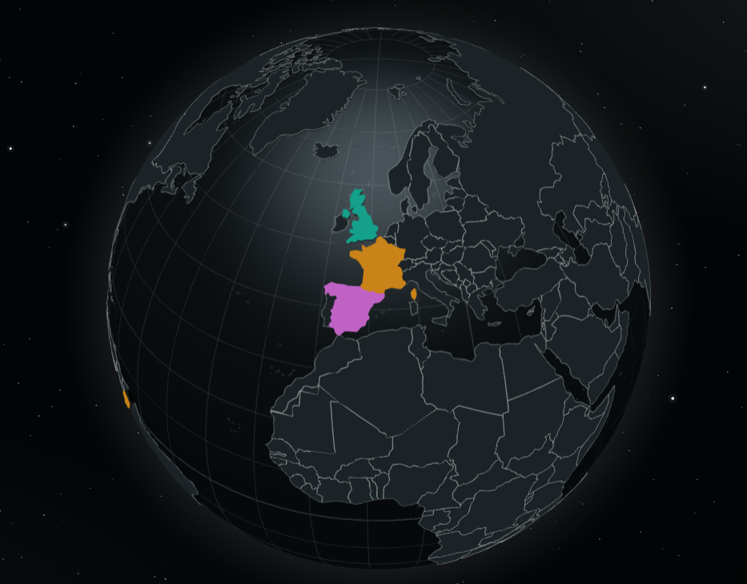
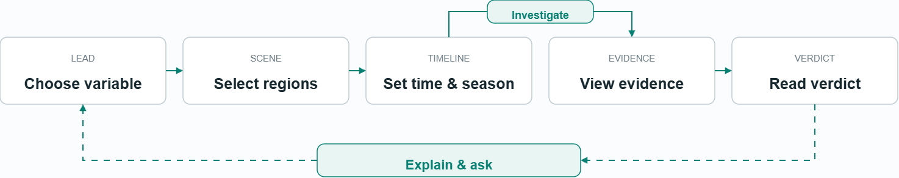
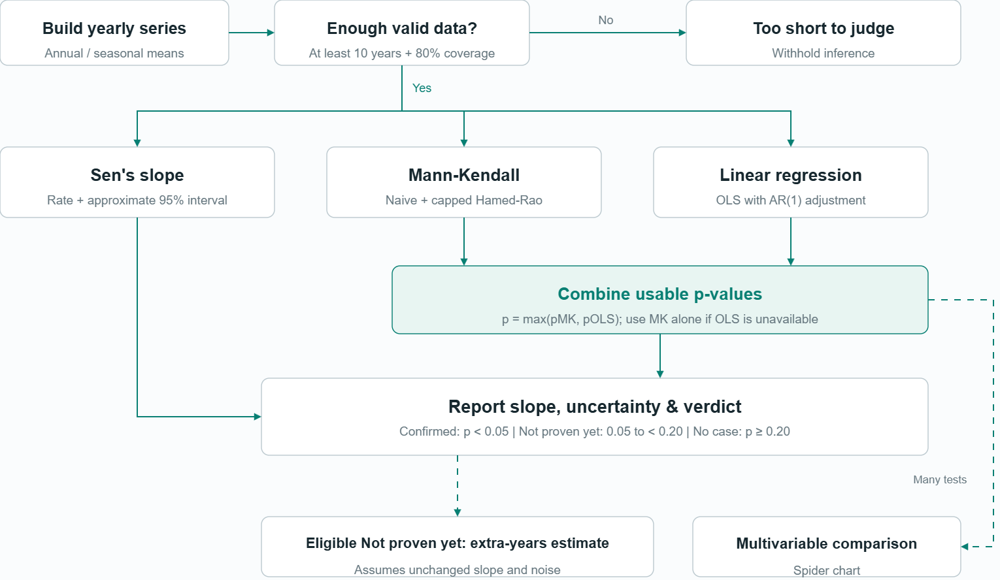
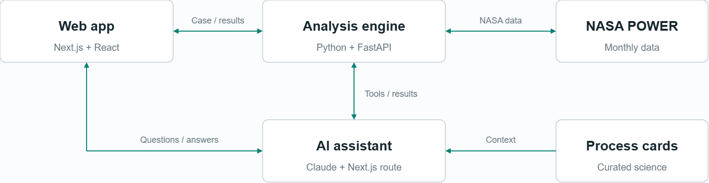
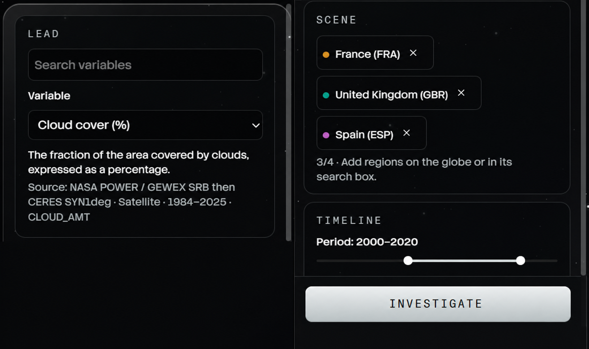
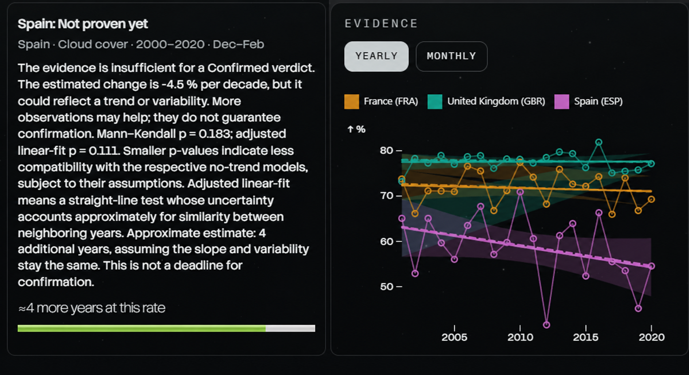
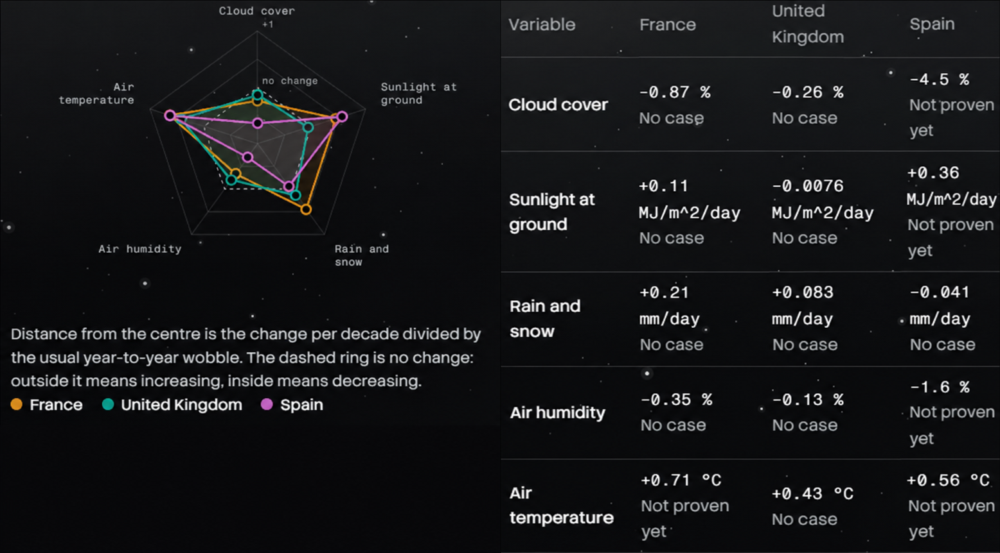
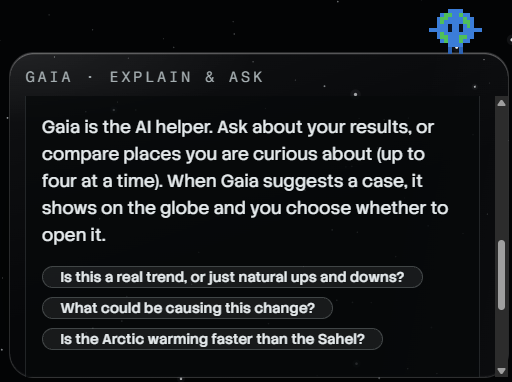

# WOMM Earth

**Read the Planet. See Beyond the Data.**

[Launch the app](https://womm-earth.vercel.app/) · [NASA Space Apps project page](https://www.spaceappschallenge.org/2026/find-a-team/worksonmymachine/?tab=project)

WOMM Earth is a guided Earth-system data investigation platform built by **WorksOnMyMachine** for the NASA Space Apps 2026 challenge **Be An Earth System Trend Detective!** Students, educators, researchers, and curious members of the public can explore environmental change through a 3D globe, time-series charts, statistical tests, and Gaia, an AI assistant that explains the evidence.



## From curiosity to evidence

1. **Lead:** choose one of 16 reviewed NASA POWER variables, including temperature, precipitation, soil wetness, snow depth, cloud cover, and aerosols.
2. **Scene:** select or search for regions on the globe; compare up to four.
3. **Timeline:** choose the start and end years and an annual, seasonal, or custom month-range aggregation.
4. **Evidence:** press **Investigate** to reveal monthly observations, anomalies, yearly or seasonal means, and rates of change.
5. **Verdict:** inspect the statistical evidence and uncertainty, then ask Gaia follow-up questions.



Case settings live in the URL so investigations can be shared. A **multivariable comparison** combines a radar chart and table to compare several environmental variables across regions.

## Statistical reasoning

Trend inference uses one annual or seasonal value per year. The engine combines:

- **Sen's slope:** the estimated rate of change, with an approximate 95% confidence interval.
- **Capped Hamed–Rao Mann–Kendall:** a test for an overall increasing or decreasing tendency, with an approximate autocorrelation correction.
- **OLS with AR(1)-adjusted uncertainty:** a straight-line trend estimate and test accounting approximately for dependence between neighbouring years.

When both tests are usable, the verdict uses `p = max(p_MK, p_OLS)`. An explicitly flagged Mann–Kendall-only fallback applies when adjusted OLS inference is unavailable.

| Verdict | Rule |
| --- | --- |
| **Confirmed** | `p < 0.05` |
| **Not proven yet** | `0.05 <= p < 0.20` |
| **No case** | `p >= 0.20` |
| **Too short to judge** | Fewer than 10 valid yearly values or less than 80% valid-year coverage |

These are conditional statistical conclusions for the selected dataset, region, period, and season. Non-detection does not establish no change, and significance does not identify a physical cause. Eligible **Not proven yet** cases may receive an approximate additional-years estimate, assuming the slope and variability remain unchanged; it is not a promised confirmation date.

Independent reference cases and simulations support numerical verification and document the limits of the approximate uncertainty corrections. See [Methods](docs/science/METHODS.md), [Limitations](docs/science/LIMITATIONS.md), and [Scientific QA](docs/science/FINAL_QA.md) for the detailed rules and review scope.

<details>
<summary>Statistical workflow diagram</summary>



</details>

## Gaia: explain and ask

Gaia uses Claude to explain results in plain language and help formulate further investigations. Its grounding instructions require:

- Statistical numbers to come from the matching analysis engine results.
- Physical explanations to come from applicable, curated, cited [process cards](docs/science/PROCESS_CARDS.md).

The statistical engine determines the verdict; Gaia interprets the evidence and its limitations. The app also supports correlation exploration, with appropriate distinctions between association and causation.

## NASA data and geographic resources

Monthly time series are retrieved through the [NASA POWER API](https://power.larc.nasa.gov/docs/services/api/temporal/monthly/), using its [parameter definitions](https://power.larc.nasa.gov/docs/tutorials/parameters/). Underlying sources include:

- [MERRA-2](https://gmao.gsfc.nasa.gov/gmao-products/merra-2/) for meteorological and land variables: model estimates constrained by observations.
- [CERES SYN1deg](https://ceres.larc.nasa.gov/data/) and the historical GEWEX Surface Radiation Budget record for the applicable radiation, cloud, and aerosol variables supplied through POWER.
- [Natural Earth](https://www.naturalearthdata.com/about/terms-of-use/) for geographic boundaries.

The Python backend forms latitude-weighted regional time series over bounding rectangles. Small regions may use a nearby grid-cell estimate. Regional averages can include areas outside named boundaries and conceal local differences; availability depends on the variable, location, and period. Full definitions, units, caveats, and attribution are in the [Data Catalogue](docs/DATA_CATALOG.md).

## Technologies and development

| Component | Technologies |
| --- | --- |
| Interface | TypeScript, React, Next.js, Tailwind CSS |
| Globe and charts | react-globe.gl, Three.js, Observable Plot |
| Analysis backend | Python, FastAPI, Pydantic, NumPy, SciPy |
| Explanations | Anthropic Claude, server-side Next.js route |
| Hosting | Vercel |
| Verification | pytest, Vitest, Playwright |



Development used Codex and Claude Code assistance alongside human review of scientific methods and explanations. See the [Architecture](docs/ARCHITECTURE.md) for the API, data flow, and implementation details.

## Run locally

Requirements: **Node.js 22 or later** and **Python 3.12**. Create and activate a Python virtual environment, then run:

```sh
npm ci
python -m pip install -r requirements-dev.txt
cp .env.example .env.local
```

Set `ANTHROPIC_API_KEY` in `.env.local` to enable Gaia. Keep the key server-side.

```sh
npm run dev
```

Open [localhost:3000](http://localhost:3000). The development command starts Next.js and FastAPI together; FastAPI listens on `127.0.0.1:8000`.

Available checks:

```sh
npm run check
python -m pytest -q
npm test
npm run test:e2e
```

## Screenshots and project-page assets

The eight supplied screenshots and diagrams are stored in [docs/assets/project](docs/assets/project/README.md).

<details>
<summary>View the app panels</summary>

**Choose a case**



**Evidence and verdict**



**Multivariable comparison**



**Gaia**



</details>

## Team

Eleder — lead and integration · Oier — data and statistics engine · Ekaitz — panels, charts, and Gaia · Sergio — methods and validity · Edur — story and submission.

Built during NASA Space Apps 2026. The [project page](https://www.spaceappschallenge.org/2026/find-a-team/worksonmymachine/?tab=project) presents the full submission.
